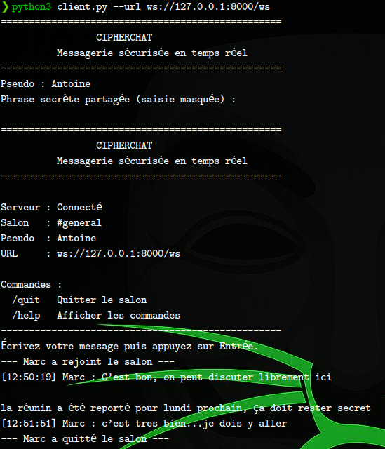
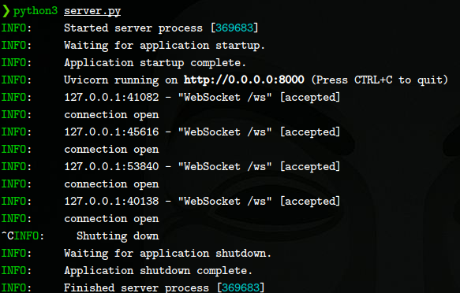

# CipherChat CLI

Messagerie en temps réel en ligne de commande. Le serveur FastAPI relaie les messages chiffrés entre les utilisateurs du salon `#general`.

**[Voir la version GUI de CipherChat](https://github.com/GedeonTch/CipherChat)**

## Aperçu

### Client CLI



### Serveur



## Fonctionnement

- `server.py` gère les connexions WebSocket, la présence et la diffusion.
- `client.py` permet de choisir un pseudo, envoyer des messages et en recevoir en temps réel.
- `encryption.py` et `protocol.py` gèrent le chiffrement et les échanges JSON.
- Aucun compte, historique ou base de données.

Les messages sont chiffrés dans le client avec **AES-256-GCM**. La clé est dérivée de la phrase secrète commune avec **PBKDF2-SHA256 (600 000 itérations)**. Chaque message utilise un nonce aléatoire et ses métadonnées sont authentifiées. Le serveur ne reçoit jamais le texte en clair ni la phrase secrète.

Utilisez une phrase longue et identique pour tous les participants. Comme la clé est partagée, elle ne prouve pas l’identité individuelle de l’auteur.

## Installation

Prérequis : **Python 3.11+**.

```bash
cd cipherchat-cli
python3 -m venv .venv
source .venv/bin/activate
pip install -r requirements.txt
```

Sous Windows PowerShell, activez l’environnement avec :

```powershell
.venv\Scripts\Activate.ps1
```

## Utilisation locale

**Terminal 1 — serveur :**

```bash
python3 server.py
```

**Terminal 2 — client :**

```bash
python3 client.py --url ws://127.0.0.1:8000/ws
```

Saisissez votre pseudo puis la phrase secrète. Ouvrez d’autres terminaux pour ajouter des utilisateurs avec la même phrase secrète.

Commandes disponibles :

- `/help` : afficher l’aide ;
- `/quit` : quitter proprement ;
- `Ctrl+C` : interrompre le client.

Le serveur expose également `GET /health` pour vérifier son état.

## Déploiement Render

**Build Command :**

```bash
pip install -r requirements.txt
```

**Start Command :**

```bash
CIPHERCHAT_ENV=production uvicorn server:app --host 0.0.0.0 --port $PORT --ws-max-size 8192 --ws-ping-interval 20 --ws-ping-timeout 20
```

Variables à configurer :

```text
CIPHERCHAT_SALT_B64=<sel-base64-stable-d-au-moins-16-octets>
CIPHERCHAT_MAX_CONNECTIONS=100
```

En production, le sel explicite est obligatoire et ne doit jamais être régénéré au démarrage. Après déploiement, connectez le client avec l’URL WSS :

```bash
python3 client.py --url wss://VOTRE-SERVICE.onrender.com/ws
```

Un service gratuit peut se mettre en veille ou redémarrer. Une surveillance de `/health`, par exemple avec UptimeRobot, ne garantit pas une disponibilité continue.

## Tests

```bash
python -m pytest -q
```

## Liens

- Dépôt de cette version CLI : **à renseigner après publication**.
- Version GUI : https://github.com/GedeonTch/CipherChat
- Service Render : **à renseigner après déploiement vérifié**.

---

**Créé par GEDEON CIBANVUNYA — 2026**
